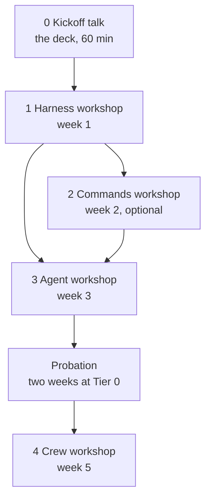

# Training path: from the harness to an agent crew

One talk and four workshops, in order, over five weeks. Each workshop is one day of about
three hours in the participant's own repository, and each one's exit gate is the next one's
entry gate.

| # | Session | When | Length | Entry gate | Leaves with |
|---|---------|------|--------|------------|-------------|
| 0 | **Kickoff talk:** deck "The Harness, Not the Model" | Before week 1 | 60 min | None | The six parts, the team's answers to the five discussion questions, three first steps with names on them |
| 1 | **[Harness workshop](WORKSHOP.md)** | Week 1 | 3 h | A real repo, a branch, a test command | Permissions, a Stop hook tested by tripping it, a context check, CLAUDE.md, a test-first skill, a read-only reviewer |
| 2 | **[Commands workshop](COMMANDS-WORKSHOP.md)** *(optional)* | Week 2 | 3 h | Session 1's exit gate, three repeated prompts | Three commands (context, action, forked), tested and shared |
| 3 | **[Agent workshop](AGENT-WORKSHOP.md)** | Week 3 | 3 h | Session 1's exit gate | One scheduled agent at Tier 0, on a routine or a GitHub Actions cron |
| — | Agent probation | Weeks 3–5 | 5 min a day, 15 min a week | — | Two weekly reviews and a tier decision |
| 4 | **[Crew workshop](CREW-WORKSHOP.md)** | Week 5 | 3 h | Session 3's exit gate and the two-week probation done | An orchestrator with MCP, API and repo workers, looped and scheduled |

The commands workshop is optional because nothing later depends on it. Run it when people
keep retyping the same prompts, or skip it and go straight from the harness to the agent.

---

## Session 0: the kickoff talk

The deck "The Harness, Not the Model" has 16 slides. Present it as a talk of about 60
minutes, the week before the harness workshop.

| Slides | Time | Do |
|--------|------|----|
| Cover to "parts" (1–5) | 15 min | The claim and the six parts |
| Loop to verify (6–12) | 15 min | One part per slide, plus the four ways a context goes bad (9) after memory; skip any part the team already does well |
| Discuss (13) | 20 min | The five questions. Write down every answer that names a repo, a command or a person |
| First steps and the training path (14–15) | 10 min | Fill the brackets on slide 14 from the discussion; show slide 15 and book the sessions |

If there's no separate slot, send the deck as a pre-read, and the harness workshop's
15-minute opening shows slides 3, 5 and 15 only.

## Before week 1

Participants:

- A real repository they work in, cloned, with a new branch.
- Claude Code installed and signed in.
- Their test command, and how long it takes.
- Whether their hooks run under Git Bash or PowerShell (Windows teams decide once).

Facilitator:

- Book all four sessions now: weeks 1, 2, 3 and 5. The crew date depends on the agent's
  probation, so don't move session 3 later without moving session 4.
- Make the exercises repository available:
  [github.com/Born-MT/claude-code-exercises](https://github.com/Born-MT/claude-code-exercises).
- Share the deck and the four workshop pages with the participants.
- **Dry-run every session yourself on one repository before it runs.** None of the hooks,
  commands, agents or crew files has been run against a live session yet. The facilitator
  dry run is their first real test, and each workshop's "Facilitator" checklist says what
  to check.

## Between sessions

| After | Participants do | Time |
|-------|-----------------|------|
| Harness | Use the harness on real work. Note in the workshop log every time the Stop hook fires and every deny that bit | A line a day |
| Commands | Use the three commands for a week, then make one revision each | A line a day |
| Agent | Probation: read every shift report and check one claim; the weekly review with `7-agent/performance-review.md` | 5 min a day, 15 min a week |
| Crew | Probation as for the agent; also record cost per cycle and which worker fails most | 5 min a day, 15 min a week |

## If someone misses a session

They can't skip ahead: each entry gate needs the evidence from the session before. They
work through the missed workshop's guide on their own repository, and a colleague who
attended checks their exit gate before the next session.

## Materials

| What | Where |
|------|-------|
| Workshop guides and starter files | This folder, and `workshops/harness/` in the exercises repository |
| Workshop log for participants | [`workshop-log.md`](workshop-log.md) |
| The deck, the workshop pages and this training path as pages | Shared by the facilitator; private until shared |
| Weekly exercises for the longer six-week programme | `weeks/` in the exercises repository |
