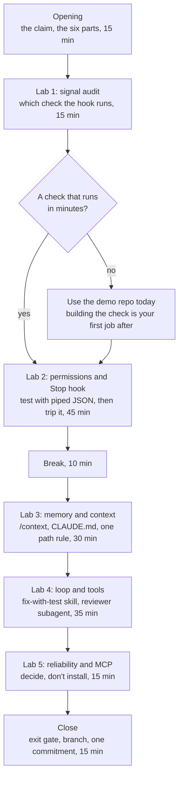

# Harness workshop: install the six parts in your own repo

**Starter files:** [README.md](README.md) · **Budget:** one 3-hour session · **Entry gate:**
a real repo, a branch, and a test command you trust

Session 1 of the [training path](TRAINING.md), after the kickoff talk on the team deck "The
Harness, Not the Model". The deck makes the claim: the same
model scores very differently depending on the harness around it. This workshop makes it
true for your repo. Everyone leaves with the starter files installed, every placeholder
filled in, the Stop hook tested by tripping it, and the lot on a branch for review.

The order follows the README's install order, not the order of the six parts. Verification
and permissions come first because everything after them depends on them. MCP and unattended
runs come last and stay as decisions, not installs, unless there's time.

---

## Entry gate

Each participant, before the day:

- [ ] A real repository you work in, cloned, on a new branch (`harness/<your-name>`). Not a
  toy repo: the placeholders only mean something in real code.
- [ ] Claude Code installed and signed in; `claude` starts in the repo.
- [ ] You know the command that runs the tests, and roughly how long it takes.
- [ ] Hooks: you know whether your machine runs them under Git Bash (use the `.sh` hook,
  needs `jq`) or PowerShell (use the `.ps1`). Windows teams decide this once, for the team.
- [ ] A copy of this folder (`templates/harness/`) to copy from.

Facilitator, before the day:

- [ ] Run Lab 2 end to end on one repo yourself: hook tested with piped JSON, then tripped
  live. The hook files have been syntax-checked but not run against a live session in
  this repo, so the facilitator run is the first real test. Fix anything that breaks
  before the session.
- [ ] Prepare one demo repo with a deliberately broken function, for anyone whose repo has
  no quick-running tests (see "If stuck").
- [ ] Have the deck open at the six-parts slide.

---

## Flow



---

## Step-by-step

| # | Step | Time | Output (evidence) | Starter files |
|---|------|------|-------------------|---------------|
| 1 | **Opening.** The claim: same model, different harness, different result. Walk the six parts once. Everyone names the part their repo is weakest at. | 15 min | One word per person on the board | Deck |
| 2 | **Lab 1** — signal audit. | 15 min | `signal-audit.md` filled in, with a decision | `6-verification/signal-audit.md` |
| 3 | **Lab 2** — permissions and the Stop hook. | 45 min | `.claude/settings.json`, `.claude/hooks/verify-before-stop.*`; three test results in the log | `5-permissions/`, `6-verification/` |
| 4 | Break. | 10 min | — | — |
| 5 | **Lab 3** — memory and context. | 30 min | Two `/context` readings; `CLAUDE.md`, one `.claude/rules/<area>.md`; one rule test; one failure and its counter named | `3-memory/` |
| 6 | **Lab 4** — loop and tools. | 35 min | `.claude/skills/fix-with-test/SKILL.md`, `.claude/agents/reviewer.md`; one skill run and one review in the log | `1-loop/`, `2-tools/reviewer.agent.md` |
| 7 | **Lab 5** — reliability and MCP, as decisions. | 15 min | Two decisions in the log | `4-reliability/`, `2-tools/mcp.json` |
| 8 | **Close.** Exit gate in pairs. Commit on the branch, open it for review. One commitment each. | 15 min | Branch or PR; commitment in the log | `workshop-log.md` |
| | **Total** | **180 min** | | |

Copy [`workshop-log.md`](workshop-log.md) into your journal before Lab 1. Every lab writes
its evidence there.

---

## Labs

### Lab 1 — Signal audit

| | |
|---|---|
| **Goal** | Pick the one check the Stop hook will run, and know whether it can be trusted. |
| **Targets** | Part 6, verification. The hook is only as good as the check it runs. |
| **Prereq** | None. |
| **Time** | 15 min |
| **Real-task shape** | Your repo's type check, unit tests, lint and build, timed. |
| **Track relevance** | Programme Week 2 Lab B; Track 3 (Test Whisperer). |

**Steps**

1. Copy `6-verification/signal-audit.md` into your journal.
2. Run each check your repo has and time it. Fill in the table.
3. Name the one thing that must never break, and whether any check would catch it.
4. Decide what the hook runs: one command, or two joined with `&&`, finishing in a few
   minutes. Write it in the **Decision** line.

**Acceptance check**

The **Decision** line names a command a peer can run in your repo, and it exits 0 on your
branch right now.

**Journal entry**

`signal-audit.md`, complete; one line in `workshop-log.md` → Lab 1.

**Common failure**

Choosing the full suite because it's the most thorough, then finding it takes 20 minutes.
Claude will wait on it every time it tries to finish. Pick the fastest check that catches
the core invariant, and leave the rest to CI.

### Lab 2 — Permissions and the Stop hook

| | |
|---|---|
| **Goal** | Claude can't read secrets, push or deploy, and can't finish while the checks fail. |
| **Targets** | Parts 5 and 6, permissions and verification. |
| **Prereq** | Lab 1 (the check command). |
| **Time** | 45 min |
| **Real-task shape** | Your repo's real deploy and migration commands; a small change that breaks a test. |
| **Track relevance** | Programme Week 0 and Week 3 Lab C; Track 2 (Gatekeeper), Track 9 (Skeptic). |

**Steps**

1. Copy `5-permissions/settings.json` to `.claude/settings.json`. If the file already
   exists, merge the `permissions` and `hooks` blocks into it instead of overwriting.
   Replace the placeholders with your real test, deploy and migration commands. Delete a
   rule you have no command for rather than leaving a placeholder in it.
2. Copy the hook for your shell to `.claude/hooks/`. Set its check command to the Lab 1
   decision. On PowerShell, change the hook entry in `settings.json` to the `powershell.exe`
   form in the README. On macOS or Linux, `chmod +x` the `.sh`.
3. **Test the hook without Claude.** From the repo root, with one file changed so the tree
   isn't clean, and with a test broken on purpose (break the code, not the test):

   ```bash
   echo '{"stop_hook_active": false}' | .claude/hooks/verify-before-stop.sh; echo "exit $?"
   ```

   ```powershell
   '{"stop_hook_active": false}' | powershell -NoProfile -File .claude/hooks/verify-before-stop.ps1; "exit $LASTEXITCODE"
   ```

   Expect exit 2 and the failing output. Repeat with `"stop_hook_active": true` (expect 0),
   then with the code fixed (expect 0). Three results.
4. **Trip it live.** Break the code again, start `claude`, and ask for an unrelated small
   change. When Claude tries to finish, the hook should block it with the failure, and
   Claude should go back and fix the code. Run `/hooks` first if nothing happens, to check
   the hook is registered.
5. **Try the deny rules.** Create a `.env` holding only `WORKSHOP_CANARY=1` if your repo has
   none (and make sure it's gitignored). Ask Claude to show you what's in `.env`, then to
   run `cat .env`. Both should be refused. Ask Claude to `git push`. Refused.
6. Record all the results in `workshop-log.md` → Lab 2.

**Acceptance check**

Three piped-JSON results (2, 0, 0) and one live session where the hook blocked a finish,
all in the log. A peer can rerun step 3 on your branch and get the same exit codes.

**Journal entry**

`workshop-log.md` → Lab 2: the three exit codes, what Claude did when blocked, which deny
attempts were refused.

**Common failure**

The hook never fires because the working tree is clean: Claude committed, or nothing
changed. The hook skips clean trees on purpose. Check `git status` shows a change before
you test. The second most common: the hook runs under the other shell. Run `/hooks` to see
the command, and match it to the file you copied.

### Lab 3 — Memory and context

| | |
|---|---|
| **Goal** | Know what's in Claude's context before you ask anything, and keep only what earns its place: a CLAUDE.md that holds what Claude can't work out from the code, and one rule that loads only where it applies. |
| **Targets** | Part 3, memory; the four ways a context goes bad and the moves that counter them. |
| **Prereq** | None. Lab 2 done, so the commands in CLAUDE.md match the ones in settings. |
| **Time** | 30 min |
| **Real-task shape** | The area of your repo Claude most often gets wrong. Examples: the data layer, generated files, one framework's conventions. |
| **Track relevance** | Programme Week 1 Lab A and Exercise 1.2; Track 1 (Onboarder), Track 4 (Archaeologist). |

**Steps**

1. **Read the context first.** Copy `3-memory/context-check.md` into your journal. Start a
   fresh session and run `/context` before asking anything. Write down the total and the
   largest consumer: memory files, MCP tools, or something else.
2. If the repo has a CLAUDE.md, open it next to `3-memory/CLAUDE.starter.md` and add only
   the sections it's missing. If not, copy the starter and fill it in. Keep it short:
   commands, boundaries, conventions, never-do rules. Delete any line that fails the test
   "would Claude plausibly get this wrong without it?".
3. Pick the area Claude gets wrong. Copy `3-memory/rule.area.md` to
   `.claude/rules/<area>.md`, set the `paths:` glob to that area, and move or write two or
   three rules for it.
4. Test one rule: in a fresh session, ask for a small change in that area that the rule
   should affect. Read the diff. Did it follow the rule? Run `/context` again and check the
   rule file is listed among the memory files.
5. **Name your failure.** From the card's table, pick the context failure your sessions
   are most prone to (poisoning, distraction, confusion or clash) and the move that
   counters it (write, select, compress or isolate). One line each, from something you've
   actually seen.
6. Record the readings, the rule test and the failure in `workshop-log.md` → Lab 3.

**Acceptance check**

`.claude/rules/<area>.md` exists with a `paths:` glob that matches at least one real file
(`git ls-files '<glob>'` lists it), and the log records two `/context` readings, one rule
test with its outcome, and one failure with its counter.

**Journal entry**

`workshop-log.md` → Lab 3: the two readings, the rule, the task, followed or not, and the
failure and counter you named.

**Common failure**

Writing a long CLAUDE.md full of things Claude can already read from the code. Every line
costs context in every session. If you can't name the mistake a line prevents, leave it
out.

### Lab 4 — Loop and tools

| | |
|---|---|
| **Goal** | Run the test-first loop as a skill, then have a subagent that can't edit review the result. |
| **Targets** | Parts 1 and 2, loop and tools. |
| **Prereq** | Lab 2 (the hook catches what the loop misses). |
| **Time** | 35 min |
| **Real-task shape** | A small bug you can reproduce with a test. Examples: an edge case in a parser, a wrong default, an off-by-one in pagination. |
| **Track relevance** | Programme Week 2 Lab A and Week 4 Lab A; Track 3 (Test Whisperer), Track 8 (Parallelizer). |

**Steps**

1. Copy `1-loop/fix-with-test.SKILL.md` to `.claude/skills/fix-with-test/SKILL.md` and
   fill in the three commands. Copy `2-tools/reviewer.agent.md` to
   `.claude/agents/reviewer.md`. Copy `1-loop/plan-template.md` to
   `docs/plans/_template.md` for later; you won't use it today.
2. Start a fresh session and run `/fix-with-test <one-sentence description of the bug>`.
   Watch for the failing test before the fix. If Claude fixes first, stop it and say so.
3. When it's done, ask: "Run `git diff`, then use the reviewer subagent to review that
   diff." The reviewer has no shell, so the main session has to hand it the diff.
4. Read the diff yourself. Compare what you found with what the reviewer found.
5. Record both in `workshop-log.md` → Lab 4.

**Acceptance check**

The log shows the test failing before the fix and passing after (command output, not a
summary), and the reviewer's findings, or its "No findings" with the list of what it
checked.

**Journal entry**

`workshop-log.md` → Lab 4: the bug, the test name, fail-then-pass, reviewer findings, what
you found that it didn't.

**Common failure**

No reproducible bug to hand. Use a recent bug from your issue tracker, or the demo repo's
broken function. Don't invent a bug by breaking working code and asking Claude to find it:
the test then proves nothing about the loop.

### Lab 5 — Reliability and MCP, as decisions

| | |
|---|---|
| **Goal** | Know what an unattended run and an MCP server would cost and risk in your repo before installing either. |
| **Targets** | Parts 4 and 2, reliability and tools. |
| **Prereq** | Labs 2–4. |
| **Time** | 15 min |
| **Real-task shape** | One job you'd like to run without a person watching, such as a nightly test-failure summary. One external system Claude would read from, such as an issue tracker. |
| **Track relevance** | Programme Week 5 Labs A and B; Track 6 (Integrator), Track 7 (Automator). |

**Steps**

1. Read `4-reliability/run-unattended.sh` with a partner. For your job, answer: what's the
   prompt, which tools does it need, what turn and budget caps, and who reads the output?
2. Read `2-tools/mcp.json`. For your external system, answer: does a read-only token
   exist, and who owns the server and the token?
3. Write both answers in `workshop-log.md` → Lab 5, ending each with *install*, *install
   after <condition>*, or *not yet*.

**Acceptance check**

Two decisions in the log, each naming an owner or a blocking condition.

**Journal entry**

`workshop-log.md` → Lab 5.

**Common failure**

Installing the MCP server with your personal, read-write token "just to try it". If there
is no read-only token, the decision is *not yet*.

---

## Exit gate (checkpoint with evidence)

Check each other's in pairs before the session ends.

| Checkpoint item | Evidence |
|-----------------|----------|
| The hook runs a check that exists and runs in minutes | `signal-audit.md` decision; the command exits 0 on the branch |
| The Stop hook blocks a finish while checks fail | Three piped-JSON exit codes and one live block in the log |
| Secrets, pushes and deploys are denied | Deny attempts in the log; no placeholders left in `settings.json` |
| CLAUDE.md and one path-scoped rule, tested once | Files on the branch; rule test in the log |
| You know what's in the context and what goes wrong with it | Two `/context` readings; one failure and its counter named |
| The test-first skill and the read-only reviewer, used once | Files on the branch; fail-then-pass output and review in the log |
| Unattended runs and MCP decided, not guessed | Two decisions with owners or conditions |
| Everything on a branch for review | Branch or PR link |

No placeholders left: `git grep -n '<.*>' .claude CLAUDE.md` should show nothing you copied
in. (It may show genuine angle brackets in your own code examples; read the matches.)

---

## Facilitator notes

- **Keep the opening to 15 minutes.** If the team saw the kickoff talk, recap the six
  parts (slide 5) and move on. If not, show slides 3, 5 and 19 of the 20 (the claim, the
  six parts, the training path) and send the deck as reading.
- **Keep the deck's setup reference open during Labs 2–4.** Slide 12 shows where every
  instruction lives and when it loads; slide 16 is the whole file layout and the commands that
  check it.
- **Lab 2 is the workshop.** If time runs short, cut Lab 5 to a homework decision and
  shorten Lab 3, but don't cut the live trip of the Stop hook. A hook nobody has seen fire
  is a hook nobody trusts.
- **Walk the room during Lab 2 step 4.** The first live block is the moment people get
  it. Ask one person to show theirs on the projector.
- **Windows rooms.** Expect a split between Git Bash and PowerShell. Pair people on the
  same shell.
- **Close with one commitment each:** the one part they'll strengthen in the next two
  weeks, and the evidence that will show it. Write it in the log.
- **Next session:** the [agent workshop](AGENT-WORKSHOP.md) puts a scheduled agent on this
  harness. Its entry gate is this workshop's exit gate.

---

## If stuck

| Symptom | Move |
|---------|------|
| Repo has no tests, or they take 20 minutes | Use the demo repo for Labs 2 and 4. Your first job after the workshop is the check from Lab 1 |
| Piped test exits 0 when you expected 2 | The tree is clean, or the check command passes. Check `git status` and run the check by hand |
| `jq: command not found` | Use the `.ps1` hook, or install `jq`. Decide once for the team |
| Hook passes the piped test but never fires live | Run `/hooks`. Wrong path, wrong shell, or `settings.json` didn't parse. Validate the JSON |
| Claude keeps retrying after the hook blocks | It shouldn't loop: the hook lets the second stop through. If it does, check that `stop_hook_active` is read correctly in your copy |
| Skill doesn't run | Check the path is `.claude/skills/fix-with-test/SKILL.md` exactly, then start a fresh session |
| Reviewer edits files | It can't with `tools: Read, Grep, Glob`. If something changed, the main session did it; check which agent ran |
| Existing `settings.json` with rules already in it | Merge, don't overwrite. Keep the stricter rule where two conflict |
